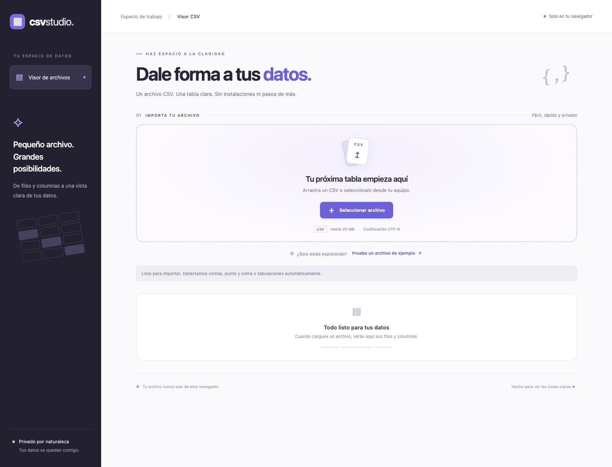
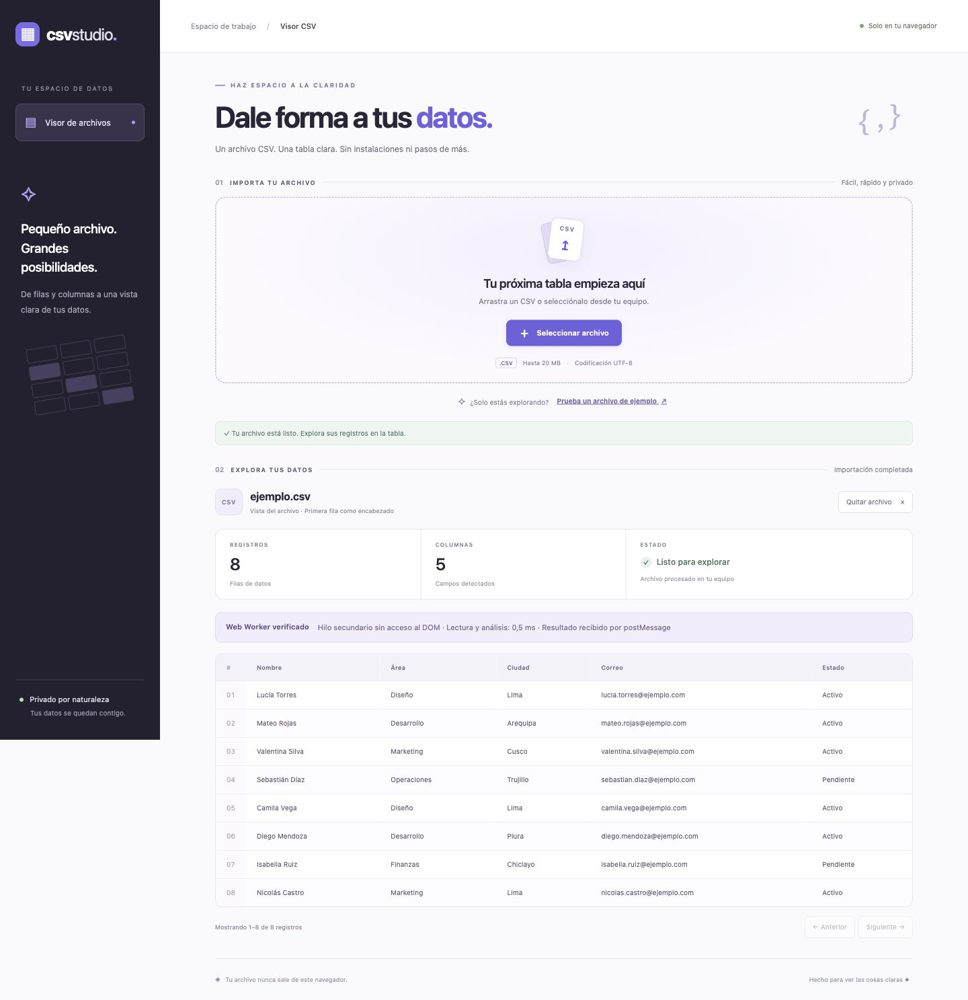

# Visualización de archivos CSV mediante Web Workers

**Universidad La Salle de Arequipa**  
**Carrera:** Ingeniería de Software  
**Curso:** Tecnologías de Construcción de Software  
**Profesor:** Luis Enrique Patiño Herrera  
**Estudiante:** [Completar nombre]  
**Fecha:** [Completar fecha]

## 1. Introducción

El proyecto permite cargar un archivo CSV y visualizar sus registros en una tabla HTML. Su propósito principal es demostrar el uso de un Web Worker para separar la lectura y el análisis del archivo de las tareas de la interfaz.

Un Web Worker ejecuta JavaScript en un hilo distinto del principal. Por ello, el procesamiento del CSV se realiza en el Worker, mientras que los eventos de usuario y la actualización de la tabla corresponden al hilo principal.

## 2. Objetivo

Implementar y comprobar la comunicación entre una página web y un Web Worker para leer, analizar y devolver los datos de un archivo CSV, mostrando posteriormente los resultados en una tabla HTML.

## 3. Implementación del Web Worker

### 3.1. Creación y envío del archivo

La clase `ServicioCsv`, definida en `servicio-csv.js`, crea una instancia de `Worker` y le envía el archivo seleccionado mediante `postMessage`.

```javascript
this.#trabajador = new Worker('worker.js');
this.#trabajador.postMessage(archivo);
```

### 3.2. Procesamiento en el hilo secundario

El archivo `worker.js` recibe el mensaje, lee el contenido con `archivo.text()` y llama a `analizarCsv`. El analizador detecta el separador, interpreta campos entre comillas y valida la cantidad de campos de cada registro.

```javascript
const inicio = performance.now();
const contenido = await archivo.text();
const resultado = analizarCsv(contenido);
```

Estas operaciones se ejecutan dentro del Worker. El Worker no tiene acceso al DOM y no construye la tabla HTML.

### 3.3. Respuesta y finalización

El Worker devuelve los encabezados y registros mediante `self.postMessage`. También devuelve una comprobación de ausencia de `document` y el tiempo empleado en leer y analizar el archivo.

```javascript
self.postMessage({
  ...resultado,
  ejecucion: {
    hilo: 'Web Worker',
    sinAccesoAlDom: typeof document === 'undefined',
    duracionMs: Number((performance.now() - inicio).toFixed(2))
  }
});
```

El hilo principal recibe el resultado, termina el Worker mediante `terminate()` y utiliza `VistaTabla` para construir la tabla. Los datos se insertan con `textContent` para evitar interpretarlos como HTML.

## 4. Flujo de ejecución

```text
Hilo principal                         Web Worker
Seleccionar archivo
Crear Worker
Enviar archivo por postMessage  →      Recibir archivo
                                       Leer contenido
                                       Analizar CSV
                                       Medir tiempo y comprobar contexto
Recibir resultado               ←      Enviar encabezados, registros y evidencia
Terminar Worker
Construir tabla HTML
```

Esta separación evita que el análisis del archivo se ejecute en el hilo de la interfaz. La construcción de la tabla permanece en el hilo principal y se pagina en bloques de hasta 50 registros para limitar la cantidad de filas renderizadas simultáneamente.

## 5. Evidencias de funcionamiento

### 5.1. Estado inicial

La página permite seleccionar o arrastrar un CSV. También ofrece un archivo de ejemplo para reproducir la prueba.

**Colocar aquí la captura `01-inicio.jpg`, centrada y conservando su proporción.**



*Figura 1. Interfaz antes de enviar el archivo al Web Worker.*

### 5.2. Resultado de la ejecución del Worker

Al cargar `ejemplo.csv`, la tabla presenta ocho registros y cinco columnas de datos. Sobre la tabla aparece el panel «Web Worker verificado», cuyo contenido procede de la respuesta del propio Worker.

El panel informa que la ejecución se realizó en un contexto sin acceso al DOM, muestra el tiempo de lectura y análisis y confirma la recepción del resultado mediante `postMessage`. En la captura de esta ejecución se registraron 0,5 ms; este valor varía entre equipos y ejecuciones y no incluye el arranque del Worker, la comunicación ni el renderizado.

**Colocar aquí la captura `03-tabla-escritorio.jpg`, centrada y con tamaño suficiente para leer el panel «Web Worker verificado». Si es necesario, ubicarla en una página propia.**



*Figura 2. Resultado del CSV y evidencia de lectura y análisis en el hilo secundario.*

La captura, junto con el código de creación del Worker y su manejador de mensajes, documenta el recorrido del archivo y su resultado. No se realizó una comparación de rendimiento con el análisis en el hilo principal; por tanto, no se afirma una mejora de velocidad medida.

## 6. Validaciones y pruebas

El servicio verifica la extensión `.csv` y un límite de 20 MB. El analizador detecta comas, punto y coma o tabulaciones; admite campos entre comillas, comillas escapadas y saltos de línea dentro de campos.

Se ejecutó `node analizador.test.cjs`, con el resultado «7 verificaciones de análisis CSV correctas». Se comprobaron separadores, BOM, comillas, archivos con solo encabezados y el rechazo de contenido vacío o inconsistente. Estas pruebas validan el analizador; la ejecución real del Worker se comprobó adicionalmente en el navegador con el archivo de ejemplo y su panel de evidencia.

## 7. Organización y buenas prácticas

Las responsabilidades se distribuyen entre el analizador, el adaptador de mensajes del Worker, el servicio que gestiona su ciclo de vida, la vista que presenta los registros y el archivo que coordina los eventos. Esta estructura aplica el principio de responsabilidad única y permite comprobar el analizador sin depender del navegador.

Las funciones y variables propias utilizan nombres en español. Se controlan errores y cargas canceladas y se termina el Worker al finalizar. La interfaz ofrece mensajes de estado, foco visible y una secuencia clara de importación y exploración.

## 8. Ejecución del proyecto

Desde la raíz del repositorio, ejecutar:

```bash
python3 -m http.server 8000
```

Abrir `http://localhost:8000` y pulsar «Prueba un archivo de ejemplo» o seleccionar un CSV. El servidor HTTP es necesario para cargar correctamente los módulos y el Worker; no se debe abrir la página directamente mediante `file://`.

## 9. Conclusiones

Se implementó la carga y visualización de un archivo CSV mediante comunicación con un Web Worker real. La lectura y el análisis se ejecutan en un hilo secundario, mientras que el hilo principal recibe los resultados y actualiza la tabla HTML.

La evidencia visible utiliza datos generados por el Worker durante la ejecución y permite relacionar la importación del archivo con el procesamiento fuera del hilo principal. El proyecto cumple el objetivo de demostrar Web Workers mediante una aplicación funcional y una estructura de código con responsabilidades separadas.
