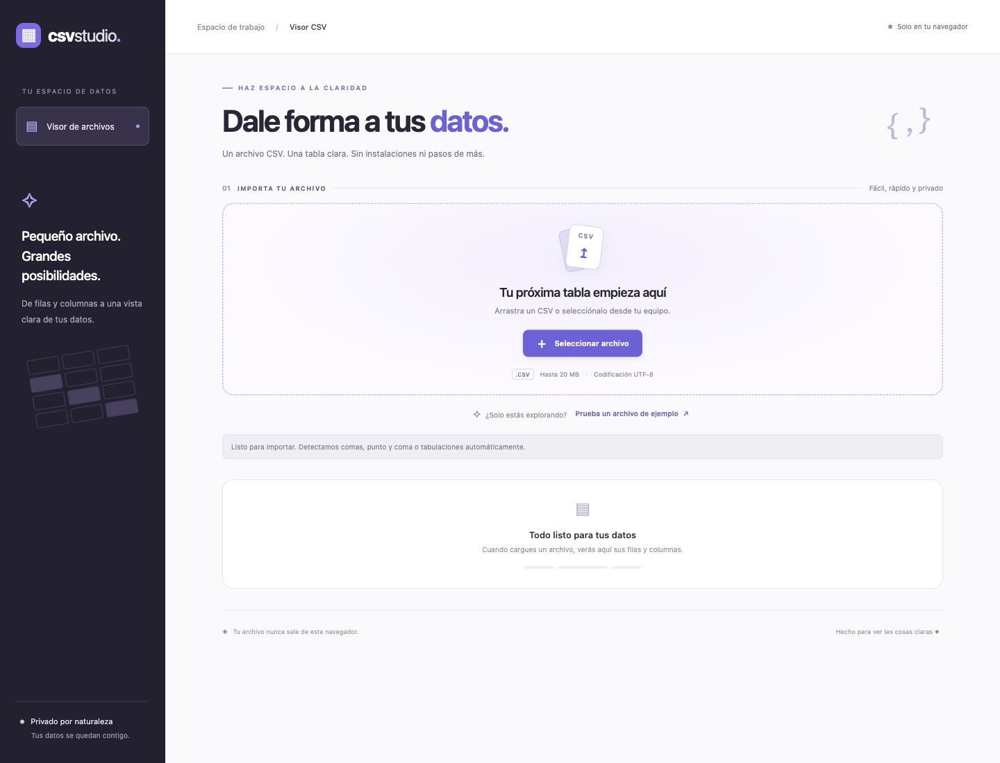
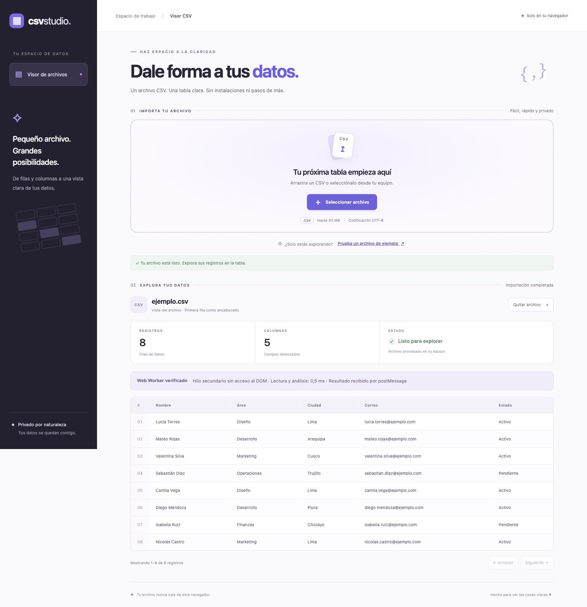

<div align="center">
  <table>
    <thead>
      <tr>
        <th>
          
        </th>
        <th>
          <strong>UNIVERSIDAD LA SALLE DE AREQUIPA</strong><br />
          <strong>FACULTAD DE INGENIERÍAS Y ARQUITECTURA</strong><br />
          <strong>DEPARTAMENTO ACADÉMICO DE INGENIERÍA Y MATEMÁTICAS</strong><br />
          <strong>CARRERA PROFESIONAL DE INGENIERÍA DE SOFTWARE</strong>
        </th>
      </tr>
    </thead>
  </table>
</div>

<div align="center">
  <h1>VISUALIZACIÓN DE ARCHIVOS CSV CON WEB WORKERS</h1>
  <strong>Tecnologías de Construcción de Software</strong><br />
  <strong>Profesor: Luis Enrique Patiño Herrera</strong>
</div>

---

## Descripción

Este proyecto permite cargar un archivo CSV y mostrar su contenido en una tabla HTML mediante JavaScript estándar y buenas prácticas.

La lectura y el análisis se realizan en un Web Worker, separado del hilo principal. La interfaz presenta los resultados mediante una tabla paginada y un diseño adaptable a escritorio. Los archivos se procesan localmente y no se envían a ningún servidor.

## Tecnologías utilizadas

[](https://developer.mozilla.org/es/docs/Web/HTML)
[](https://developer.mozilla.org/es/docs/Web/CSS)
[](https://developer.mozilla.org/es/docs/Web/JavaScript)
[](https://developer.mozilla.org/es/docs/Web/API/Web_Workers_API)

- **HTML** para la estructura y la tabla de datos.
- **CSS** para el diseño visual y la adaptación a diferentes pantallas.
- **JavaScript** con módulos y funciones y variables propias en español.
- API estándar **Web Workers**, `postMessage` y `File`.
- **Python 3** para servir los archivos localmente.
- **Node.js** para ejecutar las comprobaciones del analizador.

La aplicación no requiere instalar paquetes ni dependencias externas. El logo y las insignias de este README requieren conexión para visualizarse; la aplicación funciona sin ellos.

## Ejecución

Clonar el repositorio y abrir una terminal en su raíz:

```bash
git clone https://github.com/iamrodrigodev/web-workers.git
cd web-workers
```
 Iniciar el servidor local:

```bash
python3 -m http.server 8000
```

Abrir en un navegador moderno:

```text
http://localhost:8000
```

Seleccionar un archivo `.csv`, arrastrarlo a la zona de carga o pulsar **Prueba un archivo de ejemplo**.

La página debe abrirse mediante HTTP. Abrir `index.html` directamente con `file://` puede impedir que el navegador ejecute el Web Worker.

## Funcionamiento

```text
Archivo CSV → ServicioCsv → Web Worker → Analizador CSV
                                ↓
Tabla HTML ← VistaTabla ← Encabezados y registros
```

- `app.js` coordina los eventos y el flujo de carga.
- `servicio-csv.js` valida el archivo y administra el ciclo de vida del Worker.
- `worker.js` recibe el archivo mediante `postMessage`, lee su contenido y ejecuta el analizador fuera del hilo principal.
- `analizador-csv.js` detecta el separador y devuelve encabezados y registros.
- `vista-tabla.js` construye la tabla en el hilo principal y presenta hasta 50 registros por página.
- Al finalizar o cancelar una carga, se termina el Worker y se evita mostrar resultados desactualizados.

Se admiten archivos UTF-8 de hasta **20 MB**, con o sin BOM, separados por comas, punto y coma o tabulaciones. También se admiten campos entre comillas, comillas escapadas y saltos de línea dentro de campos.

La primera fila se utiliza como encabezado. Se omiten filas vacías y se rechazan registros con una cantidad de campos distinta a la de los encabezados. Los valores se insertan mediante `textContent` para evitar interpretarlos como HTML.

### Organización y buenas prácticas

Todos los archivos se encuentran en la raíz del proyecto:

```text
.
├── .gitignore
├── INFORME.md
├── index.html
├── styles.css
├── app.js
├── servicio-csv.js
├── worker.js
├── analizador-csv.js
├── vista-tabla.js
├── ejemplo.csv
├── analizador.test.cjs
├── 01-inicio.jpg
├── 03-tabla-escritorio.jpg
└── README.md
```

Se aplican principios SOLID adecuados al alcance del proyecto, especialmente la responsabilidad única. El analizador, el servicio del Worker, la presentación y la coordinación de eventos tienen responsabilidades separadas.

`VistaTabla` recibe sus elementos y el tamaño de página por constructor. El analizador no depende del DOM ni de las APIs del Worker, lo que permite comprobarlo por separado. Se mantienen interfaces pequeñas y se evitan jerarquías innecesarias.

### Diseño UX/UI

La interfaz organiza la tarea en dos etapas: importar el archivo y explorar sus datos. Incluye un estado vacío orientativo, mensajes de procesamiento, éxito y error, y un archivo de ejemplo.

El diseño utiliza tonos lavanda, una jerarquía visual clara y una distribución adaptable. La tabla incorpora encabezados fijos, desplazamiento horizontal y paginación. Se incluyen foco visible, navegación por teclado, anuncios accesibles de estado y respeto a la preferencia de movimiento reducido.

### Evidencia de ejecución del Web Worker

El panel **Web Worker verificado** aparece después de recibir la respuesta del hilo secundario. Los datos del panel se generan dentro de `worker.js`, no se asignan como un indicador fijo de la interfaz.

1. `ServicioCsv` crea un Worker real con `new Worker('worker.js')`.
2. El archivo se envía al Worker mediante `postMessage`.
3. Dentro del Worker se ejecutan `archivo.text()` y `analizarCsv(contenido)`.
4. El Worker verifica que `document` no está disponible y mide la lectura y el análisis con `performance.now()`.
5. El resultado y los datos de ejecución regresan mediante `self.postMessage`.
6. El hilo principal recibe el mensaje, construye la tabla y termina el Worker.

El tiempo mostrado corresponde a lectura y análisis dentro del Worker; no incluye la creación del Worker, la transferencia del mensaje ni el renderizado de la tabla. Puede variar entre equipos y ejecuciones. El Worker no modifica el DOM.

## Resultado esperado

Al cargar `ejemplo.csv`, la aplicación muestra una tabla con **8 registros y 5 columnas**, además de una columna auxiliar de numeración.

```text
Archivo: ejemplo.csv
Registros: 8
Columnas: 5
Estado: Listo para explorar
Encabezados: Nombre, Área, Ciudad, Correo, Estado
```

Los datos aparecen en una tabla HTML. El usuario puede quitar el archivo y comenzar otra importación.

## Comprobación

Ejecutar las verificaciones del analizador desde la raíz:

```bash
node analizador.test.cjs
```

Resultado esperado:

```text
7 verificaciones de análisis CSV correctas.
```

Las verificaciones cubren:

- Separador punto y coma, BOM y finales de línea CRLF.
- Comillas escapadas y saltos de línea dentro de campos.
- Tabulaciones y omisión de filas vacías.
- Archivos que contienen únicamente encabezados.
- Rechazo de registros con una cantidad de campos inconsistente.
- Rechazo de campos con comillas sin cerrar.
- Rechazo de archivos vacíos.

También se comprobó en el navegador la carga del archivo de ejemplo, la visualización de sus registros, la limpieza de la tabla y la distribución en escritorio.

## Evidencia de la prueba

### Pantalla inicial

Zona de carga, instrucciones de importación y estado vacío antes de seleccionar un archivo.



### Archivo procesado en escritorio

Importación exitosa del archivo de ejemplo y tabla HTML. El panel «Web Worker verificado» presenta información devuelta desde el propio Worker: ejecución sin acceso al DOM, duración real de la lectura y el análisis, y recepción mediante `postMessage`.



